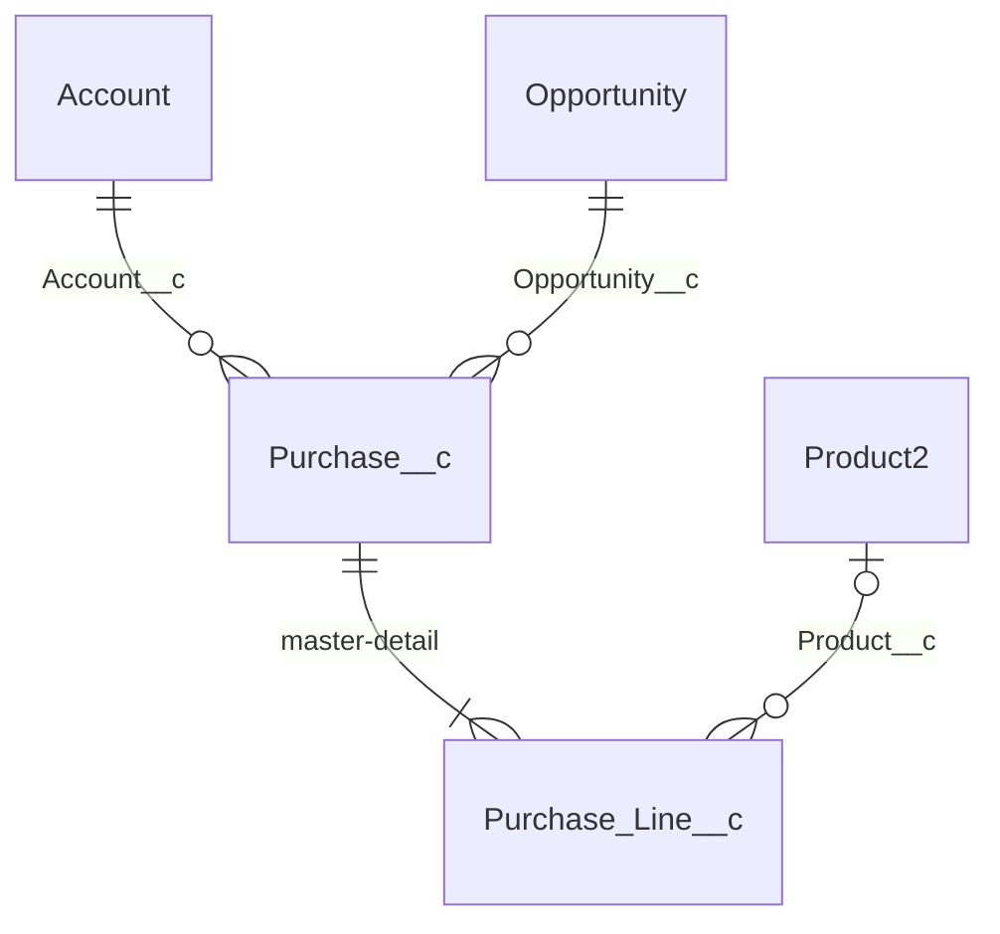

# Order Desk

A small Salesforce app that turns the products of an **Opportunity** into a customer **purchase**: pick products, collect them in a cart, submit, and the customer gets a receipt by email.

Built by **Serafima Kogan** ([@SimaKogan](https://github.com/SimaKogan), serafima.kogan@gmail.com).

## Screenshots

> These are **UI previews rendered locally from a static mock with sample data** (same layout, same numbers as `scripts/apex/seed-demo-data.apex`), not captures of a live org. Replace them with real captures after your first deploy; the file names can stay the same.

| Cart with items | Empty cart |
| --- | --- |
|  |  |

| Nothing selected yet | Submitted, with the receipt email |
| --- | --- |
|  |  |

## What it does

1. Open the **Order Desk** app and choose an open opportunity (or drop the component on an Opportunity record page).
2. Enter quantities next to its products and choose **Add to cart**. Quantities are checked against what is still available.
3. Review the cart, remove lines if needed, enter the receipt address and **Submit purchase**.
4. The purchase becomes `Submitted`, the date is stamped, and a plain-text receipt is emailed.

Opportunity products are never modified. Stock is tracked by *reserving* quantities on purchase lines, so cancelling a purchase releases its units again.

## Built with

- **Apex**: Java-style, strongly typed server code (service layer, bulk-safe trigger, tests)
- **JavaScript**: Lightning Web Components (ES modules, async/await, custom events)
- **Node.js tooling**: Jest, ESLint and Prettier for the front-end code
- **Salesforce DX**: source-format project, scratch org, `sf` CLI

## Data model



| Object | Notable fields |
| --- | --- |
| `Purchase__c` | `Status__c` (Draft / Submitted / Cancelled), `Receipt_Email__c`, `Submitted_On__c`, `Receipt_Sent__c`, `Total_Amount__c` (roll-up) |
| `Purchase_Line__c` | `Quantity__c`, `Unit_Price__c`, `Line_Total__c` (formula), `Opportunity_Product_Id__c`, `Line_Key__c` (unique: one line per product per purchase) |

Also included: validation rules, page layouts, a list view, the **Order Desk** Lightning app, tabs, a Lightning app page, and two permission sets.

| Permission set | Grants |
| --- | --- |
| `Order_Desk_User` | create/read/edit purchases, create/read/edit/delete lines, the app and tabs, the Apex controller |
| `Order_Desk_Manager` | everything above plus view-all and delete on purchases |

Users also need read access to Accounts, Opportunities and Products (the Standard User profile has it).

## Apex

| Class | Role |
| --- | --- |
| `PurchaseTrigger` + `PurchaseTriggerHandler` | Bulk-safe life cycle guard: created as Draft, Draft → Submitted/Cancelled, Submitted → Cancelled, account and opportunity fixed, a submit needs at least one line (one aggregate query for any number of records) |
| `OrderDeskService` | Business logic: desk state, add to cart (fixed number of queries and DML for any number of lines), remove line, submit one or many purchases |
| `ReceiptMailer` | One `Messaging.sendEmail` call for a whole batch; sets `Receipt_Sent__c` only for emails that were accepted |
| `OrderDeskController` | Thin `@AuraEnabled` facade; business errors are shown as-is, anything unexpected is logged and replaced by a generic message |

Queries and DML run in **user mode** (`WITH USER_MODE`, `insert as user`), and classes are `with sharing`, so field-level security, object permissions and sharing of the running user always apply.

## Lightning Web Components

| Component | Role |
| --- | --- |
| `orderDesk` | Container: opportunity picker, summary, loading and error handling, toasts |
| `orderLineList` | Products with available units and quantity inputs (values are clamped to what is available) |
| `cartPanel` | Cart lines, total, receipt address, submit |
| `emptyState` | Reusable empty state with an inline SVG |
| `errorUtils` | Shared error-message helper |

No `eval`, no `setTimeout`, no external CDNs or static resources. Child components talk to the container through events, so there is no message channel to maintain.

## Deploy

Requires the [Salesforce CLI](https://developer.salesforce.com/tools/salesforcecli) (`sf`).

```bash
# 1. scratch org (or log in to a sandbox / Developer Edition org instead)
sf org create scratch --definition-file config/project-scratch-def.json --alias order-desk --set-default

# 2. deploy everything
sf project deploy start

# 3. give yourself access and load demo data
sf org assign permset --name Order_Desk_Manager
sf apex run --file scripts/apex/seed-demo-data.apex

# 4. open the org, then launch the "Order Desk" app
sf org open
```

## Tests

```bash
# Apex: runs every test and reports coverage per class
sf apex run test --test-level RunLocalTests --code-coverage --result-format human --wait 10

# Lightning Web Components
npm install
npm run lint
npm run test:unit:coverage
```

The Apex suite covers the service, trigger, mailer and controller, including a 200-record trigger run, a 100-line bulk add with query and DML limit assertions, and a user without permissions. Check the coverage report on your org; the target is above 85 %.

## Project layout

```
force-app/main/default
├── applications/   Order Desk app
├── classes/        service, controller, mailer, trigger handler + tests
├── flexipages/     Order Desk app page
├── layouts/ objects/ permissionsets/ tabs/
├── lwc/            orderDesk, orderLineList, cartPanel, emptyState, errorUtils (+ Jest tests)
└── triggers/       PurchaseTrigger
```

## Notes

- Email deliverability must allow sending (Setup → Deliverability). When it does not, the purchase is still submitted and the app tells the user the receipt could not be sent.
- API version 62.0.

## License

MIT, see [LICENSE](LICENSE).
