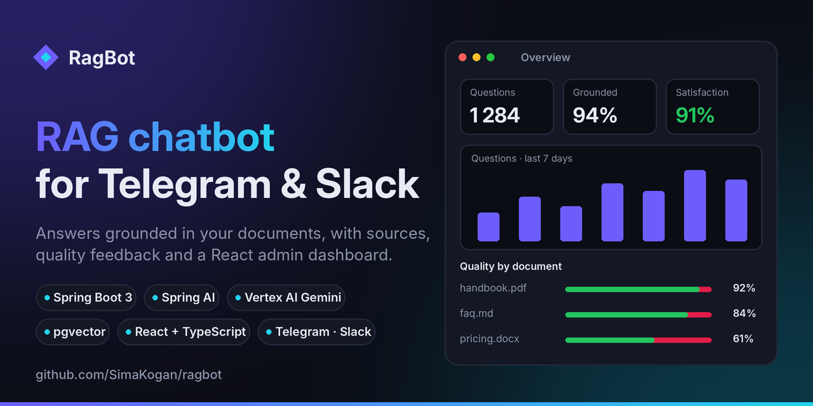
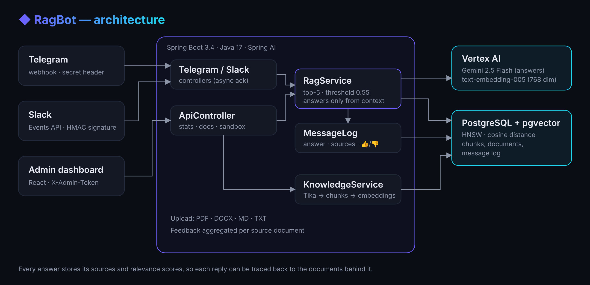
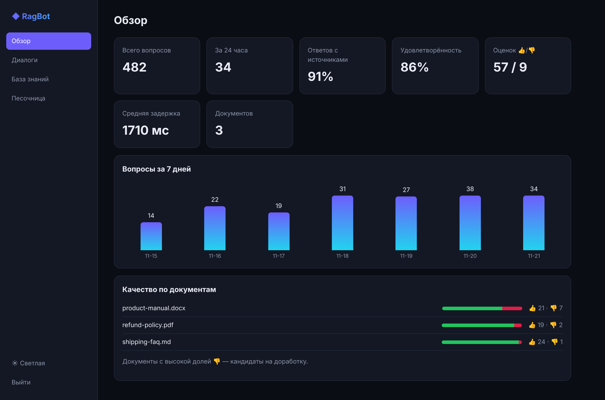
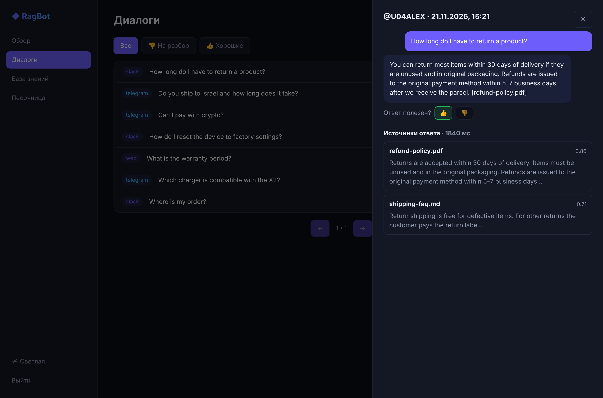
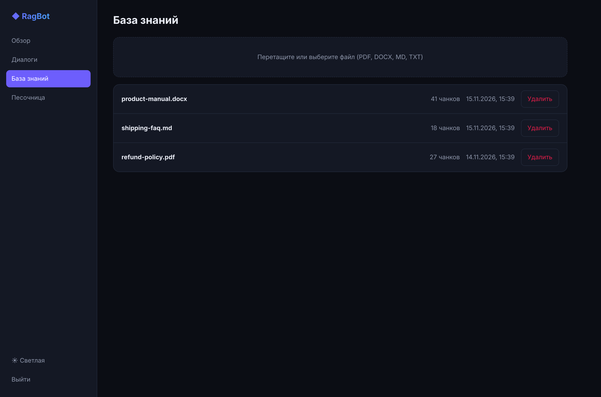
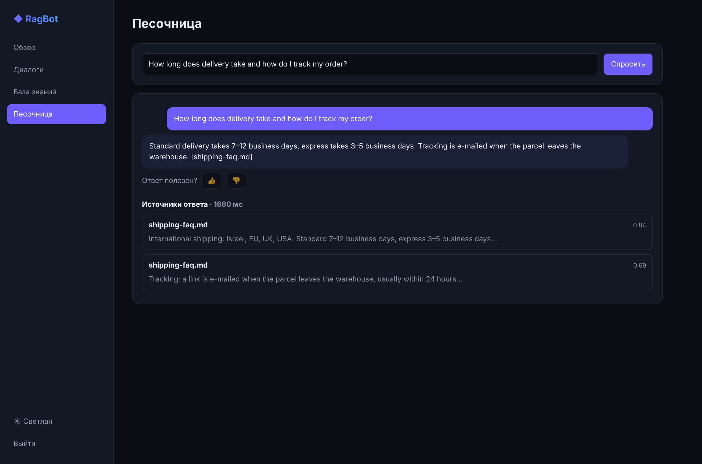

**English** | [Русский](README.ru.md)

# RagBot: a RAG chatbot for Telegram & Slack with an admin dashboard



RagBot answers questions from **your own documents** and shows the sources behind every answer. Upload PDF, DOCX, Markdown or text files, ask questions in Telegram, Slack or the built-in sandbox, and rate each answer with 👍/👎. The dashboard turns those ratings into a per-document quality report, so you can see which files make answers worse.

**Stack:** Java 17 · Spring Boot 3.4 · Spring AI 1.0 · Gemini 2.5 Flash and text-embedding-005 (Vertex AI) · PostgreSQL + pgvector · React 18 + TypeScript + Vite · Docker Compose

## How it works



1. **Ingestion.** An uploaded file is parsed with Apache Tika, split into chunks (`TokenTextSplitter`), embedded with `text-embedding-005` (768 dimensions) and stored in pgvector (HNSW index, cosine distance).
2. **Retrieval.** A question is embedded and the top 5 chunks with similarity of at least 0.55 are fetched.
3. **Generation.** Gemini 2.5 Flash (temperature 0.2) is told to answer only from the retrieved context and to cite sources as `[file_name]`. If nothing passes the threshold, the bot says it has no information and **does not call the model at all**.
4. **Logging.** Each exchange is saved as a `MessageLog` row: question, answer, sources with snippets and scores, latency, channel and the user's 👍/👎.

## Dashboard

The UI language is Russian; there is a dark and a light theme. Screenshots below use demo data.

| Overview | Conversations and sources |
| --- | --- |
|  |  |
| **Knowledge base** | **Sandbox** |
|  |  |

- **Overview:** total questions, last 24 hours, share of answers that had sources, satisfaction, 👍/👎 counts, average latency, number of documents, a 7-day chart, and quality per document.
- **Conversations:** all messages with filters *All*, *👎 To review* and *👍 Good*. Click a row to see the answer, its sources with relevance scores, and rate it.
- **Knowledge base:** upload (up to 20 MB) and delete documents.
- **Sandbox:** the same RAG pipeline without a messenger.

## Quick start

1. In Google Cloud, enable the Vertex AI API, create a service account with the **Vertex AI User** role and download its key as `gcp.json`.
2. Run `cp .env.example .env` and fill in the values (get the bot token from @BotFather).
3. Run `docker compose up --build`. The dashboard is at http://localhost:8080 (log in with `ADMIN_TOKEN`).
4. Upload documents in the **Knowledge base** tab and check the answers in the **Sandbox**.
5. Connect Telegram (needs a public HTTPS URL; locally use ngrok or cloudflared):

```bash
curl "https://api.telegram.org/bot$TELEGRAM_TOKEN/setWebhook" \
  -d url=https://<host>/api/telegram/webhook -d secret_token=$TELEGRAM_WEBHOOK_SECRET
```

Before exposing the app, replace the `change-me` defaults for `ADMIN_TOKEN` and `TELEGRAM_WEBHOOK_SECRET`.

## Slack

1. Go to https://api.slack.com/apps → Create New App → From scratch.
2. OAuth & Permissions → Bot Token Scopes: `chat:write`, `app_mentions:read`, `im:history` → Install to Workspace → put the `xoxb-…` token into `SLACK_BOT_TOKEN`.
3. Basic Information → Signing Secret → `SLACK_SIGNING_SECRET`.
4. Event Subscriptions → Request URL `https://<host>/api/slack/events` → bot events: `app_mention`, `message.im`.
5. Interactivity & Shortcuts → Request URL `https://<host>/api/slack/interactions` (👍/👎 buttons).
6. App Home → enable the Messages Tab and allow users to message the bot. The bot replies in a thread when mentioned and in direct messages.

## Answer quality feedback

Every answer carries 👍/👎: inline buttons in Telegram, Block Kit buttons in Slack (both disappear after a click), and buttons in the dashboard and sandbox. The rating is stored in `MessageLog.feedback`. The dashboard shows:

- **Satisfaction** = 👍 / (👍 + 👎) over 7 days, plus the number of ratings;
- **Quality per document**: 👍/👎 among answers where the document was a source, sorted by the number of 👎;
- **Conversations → "👎 To review"**: a queue of bad answers with their sources and scores.

## Security

- `/api/**` (dashboard API) requires the `X-Admin-Token` header.
- The Telegram webhook checks `X-Telegram-Bot-Api-Secret-Token` with a constant-time comparison.
- Slack requests are verified with `X-Slack-Signature` (HMAC-SHA256, 5-minute window against replay); Slack retries are ignored.
- All secrets come from environment variables; `.env` and `gcp.json` are git-ignored.
- Webhooks are acknowledged immediately and processed on a background thread pool, because Slack requires an answer within 3 seconds.

## Development

- Backend: `cd backend && mvn spring-boot:run` (needs a running database: `docker compose up db`)
- Tests: `cd backend && mvn test` (Slack signature verification and the admin token filter)
- Dashboard: `cd dashboard && npm install && npm run dev` (proxies to :8080)
- Health: `/actuator/health`

## Limitations and roadmap

- Each question is answered independently, with no conversation history.
- The dashboard uses one shared admin token instead of user accounts.
- The schema is created by Hibernate (`ddl-auto: update`) and there are no integration tests yet.

Planned: response streaming, automatic LLM-as-judge quality scoring (faithfulness / relevance) on top of manual 👍/👎, Flyway migrations, Testcontainers tests, and virtual threads on Java 21.
