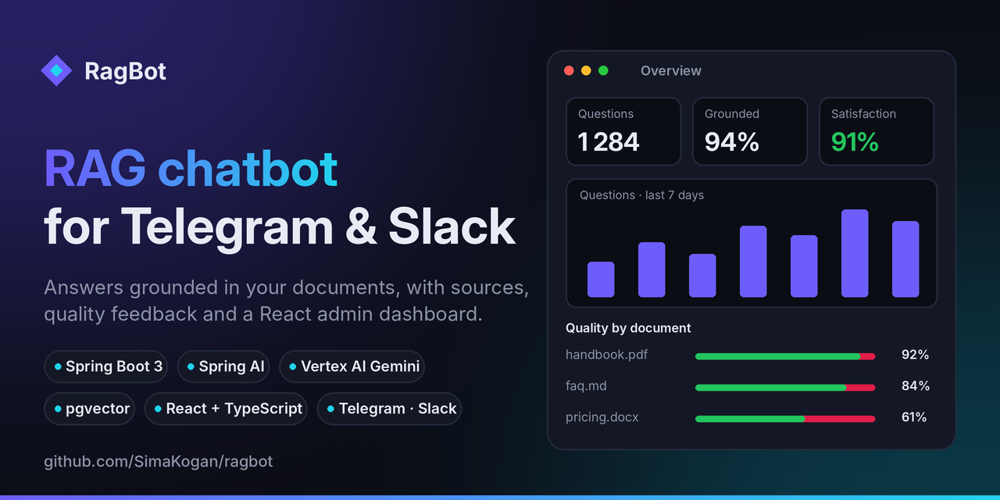
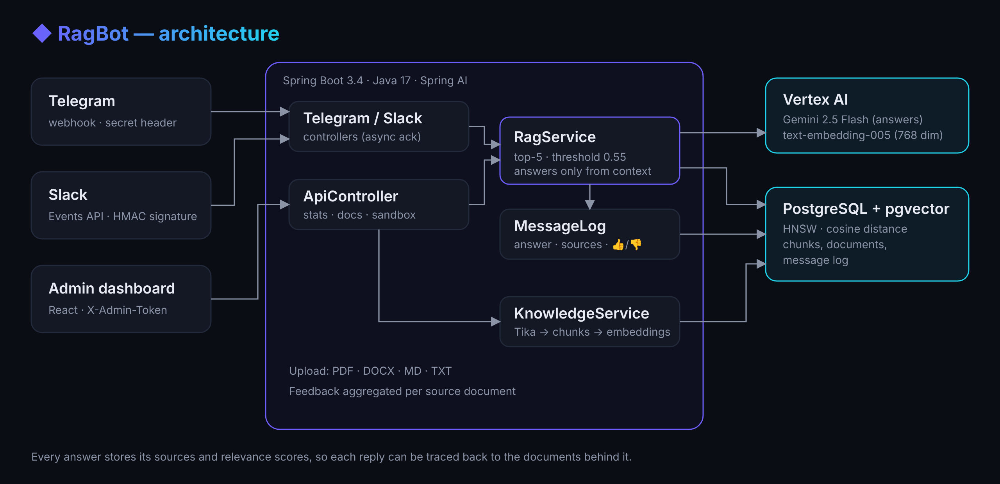
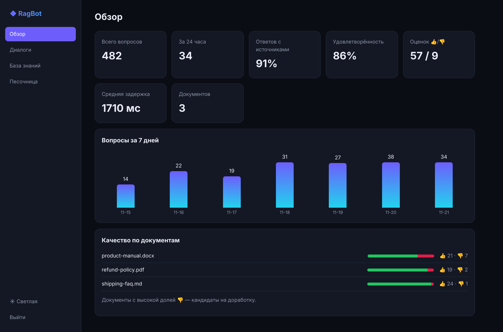
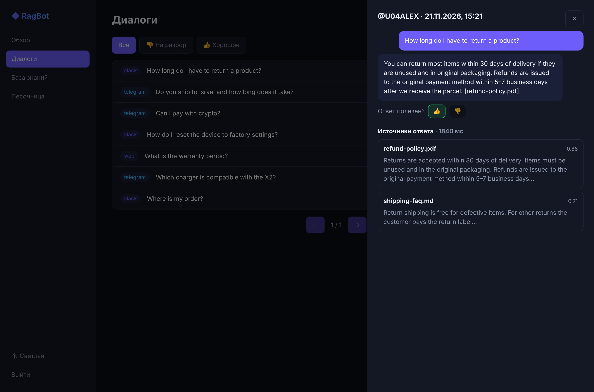
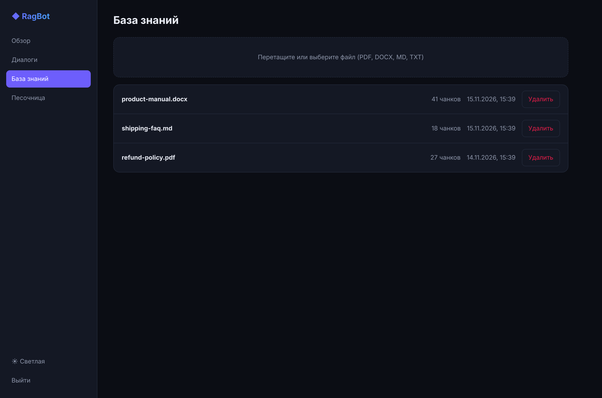
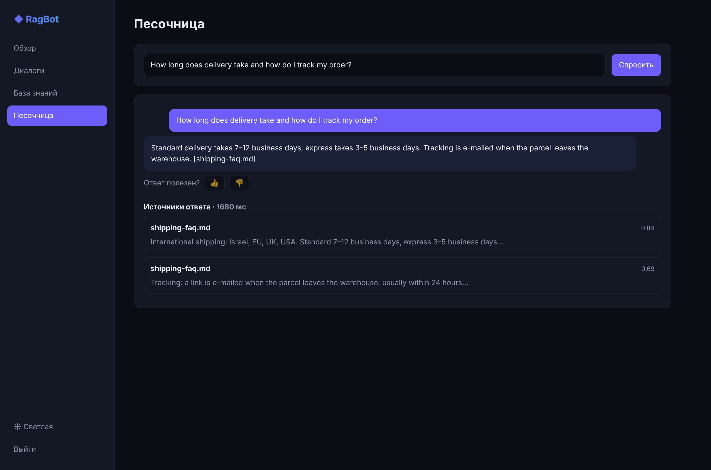

[English](README.md) | **Русский**

# RagBot: RAG-чатбот для Telegram и Slack с панелью управления



RagBot отвечает на вопросы **по вашим документам** и показывает источники каждого ответа. Загрузите PDF, DOCX, Markdown или текстовые файлы, задавайте вопросы в Telegram, Slack или во встроенной песочнице и оценивайте ответы кнопками 👍/👎. Панель превращает оценки в отчёт о качестве по документам: видно, какие файлы ухудшают ответы.

**Стек:** Java 17 · Spring Boot 3.4 · Spring AI 1.0 · Gemini 2.5 Flash и text-embedding-005 (Vertex AI) · PostgreSQL + pgvector · React 18 + TypeScript + Vite · Docker Compose

## Как это работает



1. **Индексация.** Загруженный файл разбирается Apache Tika, режется на чанки (`TokenTextSplitter`), превращается в эмбеддинги `text-embedding-005` (768 измерений) и сохраняется в pgvector (индекс HNSW, косинусное расстояние).
2. **Поиск.** Вопрос превращается в эмбеддинг, из базы берутся 5 ближайших чанков со сходством не ниже 0,55.
3. **Генерация.** Gemini 2.5 Flash (temperature 0,2) получает инструкцию отвечать только по найденному контексту и ссылаться на источники в виде `[имя_файла]`. Если ничего не прошло порог, бот сообщает, что информации нет, и **вообще не обращается к модели**.
4. **Журнал.** Каждый обмен сохраняется как запись `MessageLog`: вопрос, ответ, источники с фрагментами и оценками сходства, задержка, канал и оценка 👍/👎.

## Панель управления

Интерфейс на русском, есть тёмная и светлая темы. Скриншоты ниже сделаны на демо-данных.

| Обзор | Диалоги и источники |
| --- | --- |
|  |  |
| **База знаний** | **Песочница** |
|  |  |

- **Обзор:** всего вопросов, за 24 часа, доля ответов с источниками, удовлетворённость, счётчик 👍/👎, средняя задержка, число документов, график за 7 дней и качество по документам.
- **Диалоги:** все сообщения с фильтрами «Все», «👎 На разбор» и «👍 Хорошие». По клику открываются ответ, источники с оценками сходства и кнопки оценки.
- **База знаний:** загрузка (до 20 МБ) и удаление документов.
- **Песочница:** тот же RAG-конвейер без мессенджера.

## Запуск

1. В Google Cloud включите Vertex AI API, создайте service account с ролью *Vertex AI User*, скачайте ключ в `gcp.json`.
2. `cp .env.example .env` и заполните значения (токен бота — у @BotFather).
3. `docker compose up --build` → панель на http://localhost:8080 (вход по `ADMIN_TOKEN`).
4. Загрузите документы во вкладке «База знаний», проверьте ответы в «Песочнице».
5. Подключите Telegram (нужен публичный HTTPS, локально — ngrok / cloudflared):

```bash
curl "https://api.telegram.org/bot$TELEGRAM_TOKEN/setWebhook" \
  -d url=https://<host>/api/telegram/webhook -d secret_token=$TELEGRAM_WEBHOOK_SECRET
```

Перед публикацией замените значения по умолчанию `change-me` для `ADMIN_TOKEN` и `TELEGRAM_WEBHOOK_SECRET`.

## Slack

1. https://api.slack.com/apps → *Create New App* → From scratch.
2. **OAuth & Permissions** → Bot Token Scopes: `chat:write`, `app_mentions:read`, `im:history` → Install to Workspace → `xoxb-…` в `SLACK_BOT_TOKEN`.
3. **Basic Information** → Signing Secret → `SLACK_SIGNING_SECRET`.
4. **Event Subscriptions** → Request URL `https://<host>/api/slack/events` → события бота: `app_mention`, `message.im`.
5. **Interactivity & Shortcuts** → Request URL `https://<host>/api/slack/interactions` (кнопки 👍/👎).
6. **App Home** → включите *Messages Tab* и разрешите писать боту. Бот отвечает в треде на упоминание и в личке.

## Оценка качества ответов

Под каждым ответом стоят 👍/👎: inline-кнопки в Telegram, Block Kit в Slack (после нажатия кнопки пропадают), кнопки в панели и песочнице. Оценка пишется в `MessageLog.feedback`. В панели:

- **Удовлетворённость** = 👍 / (👍 + 👎) за 7 дней и счётчик оценок;
- **Качество по документам:** 👍/👎 среди ответов, где документ был источником, отсортировано по числу 👎;
- **Диалоги → «👎 На разбор»:** очередь плохих ответов с источниками и оценками сходства.

## Безопасность

- `/api/**` (API панели) требует заголовок `X-Admin-Token`.
- Вебхук Telegram проверяет `X-Telegram-Bot-Api-Secret-Token` сравнением за постоянное время.
- Запросы Slack проверяются по подписи `X-Slack-Signature` (HMAC-SHA256, окно 5 минут против повторов), ретраи Slack игнорируются.
- Все секреты берутся из переменных окружения; `.env` и `gcp.json` в `.gitignore`.
- Вебхуки подтверждаются сразу, а обработка идёт в фоновом пуле потоков: Slack требует ответ за 3 секунды.

## Разработка

- Бэкенд: `cd backend && mvn spring-boot:run` (нужна запущенная БД: `docker compose up db`)
- Тесты: `cd backend && mvn test` (проверка подписи Slack и фильтр токена администратора)
- Панель: `cd dashboard && npm install && npm run dev` (прокси на :8080)
- Состояние: `/actuator/health`

## Ограничения и планы

- Каждый вопрос обрабатывается независимо, истории диалога нет.
- Панель защищена одним общим токеном, учётных записей пользователей нет.
- Схему БД создаёт Hibernate (`ddl-auto: update`), интеграционных тестов пока нет.

В планах: стриминг ответов, автооценка качества LLM-as-judge (faithfulness / relevance) поверх ручных 👍/👎, миграции Flyway, тесты на Testcontainers и виртуальные потоки на Java 21.
